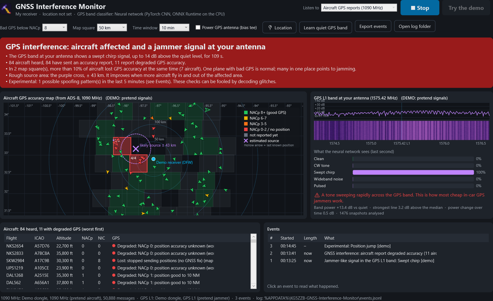

# KG5ZZB - GNSS Interference Monitor


**Passive GPS jamming and spoofing monitor for Windows with a low-cost RTL-SDR: maps where aircraft report degraded GNSS accuracy (ADS-B NACp/NIC), estimates the interference source area, and classifies jammer signals in the GPS L1 band with a convolutional neural network.**

The app listens to 1090 MHz, decodes Mode S / ADS-B extended squitter, and reads each aircraft's own navigation accuracy and integrity reports (NACp and NIC, DO-260B). When many aircraft in one area report bad GPS at the same time, it flags that map square, estimates where the jammer probably is (with a 1-sigma uncertainty), and logs an event. With a GPS antenna on 1575.42 MHz, a small CNN (PyTorch, ONNX Runtime) classifies what is in the L1 band ten times per second: clean, CW tone, swept chirp, wideband noise or pulsed. Experimental heuristics flag track patterns that suggest spoofing.

It is **receive-only**: it never transmits, jams or interferes with anything.



> **Status: v0.1.0.** Mode S demodulator and ADS-B decoder with NIC/NACp extraction, gpsjam-style grid aggregation, altitude-aware source estimation, spoofing heuristics, GPS L1 spectrum analysis with an embedded CNN, JSON Lines / CSV event log and a built-in demo all work. 78 automated tests (xUnit), run in CI on every push.

---

## What it does

### ✈️ Aircraft as GNSS sensors (ADS-B, 1090 MHz)
- **Decodes Mode S** at 2 MS/s (preamble detection, pulse-position bits, CRC-24) and ADS-B **identification, airborne position (CPR, global and local), velocity and operational status** messages.
- **Reads the navigation indicators** every modern transponder broadcasts:
  - **NACp** (TC 31 operational status, ME bits 45-48): the 95% horizontal accuracy bound, from 3 m (NACp 11) to "unknown" (NACp 0).
  - **NIC** (position type code + NIC supplement A from TC 31 and supplement B from the position message): the containment radius Rc, from 7.5 m to over 20 NM. Version 0, 1 and 2 tables.
  - Also SIL, NACv and the ADS-B version. Field positions follow *The 1090 Megahertz Riddle* (Junzi Sun).
- **Classifies each aircraft** as good, degraded (NACp below 8 or NIC below 7, both adjustable) or *lost position* (it keeps sending airborne position messages with no position in them, typical when GNSS is gone). Aircraft that stop sending positions are dead-reckoned from their last fix and velocity.
- **Aggregates per map square** (25/50/100 km) over a sliding window (5-60 min) with the published gpsjam.org rule, `percent_bad = 100 * (bad - 1) / (good + bad)`: under 2% normal, 2-10% some, over 10% high. Subtracting one aircraft keeps a single plane with old avionics from painting a square red. A square needs at least 3 aircraft, and an alert needs at least 2 degraded ones.

### 🎯 Where is the jammer?
- The app records **edge crossings**: the last good position of each aircraft that lost accuracy, and the first good position of each one that recovered.
- **Altitude-aware circle fit:** a ground jammer reaches further at higher altitude (line of sight), so the edge is modelled as `|p_i - c| = R0 + k * altitude_i`. Kasa algebraic fit, then Gauss-Newton on the geometric residuals, outlier rejection, and a parameter covariance `s^2 (J^T J)^-1` that gives the **1-sigma uncertainty** shown on the map. A burst of simultaneous losses (the jammer switching on with aircraft already inside) is left out because it does not mark the edge.
- With too few crossings, or crossings that do not surround the centre, it falls back to the **weighted centroid** of degraded aircraft, with a correspondingly larger uncertainty.

### 🕵️ Spoofing heuristics (experimental)
- **Position jump:** the position moves faster than any aircraft can fly *and* the track continues from the new place (one glitch does not count; CPR pairs that straddle the jump are decoded locally to avoid garbage positions).
- **Convergence:** three or more aircraft that were tens of km apart a minute ago now report almost the same position, the classic pattern of area spoofing.
- **Velocity mismatch:** the reported integrity is good, but the track from positions disagrees with the reported ground speed and track.
- **Beyond radio range:** a position farther away than any aircraft could be heard from, with good integrity.

### 📡 GPS L1 band at your antenna (1575.42 MHz)
- Tunes an RTL-SDR to L1 at 2.4 MS/s (optionally powering an active antenna through the bias tee) and learns the **quiet noise floor** of the band. GPS signals are about 20 dB below the noise, so a clean band is flat; anything above it is something else.
- Every 100 ms a 4096-sample capture becomes a **64 x 64 spectrogram** (64-point FFTs, Hann window, 37.5 kHz x 26.7 us), in dB above the quiet floor, and the **CNN** classifies it. Probabilities are averaged over one second; an event opens after a second of confident jammer classification and closes after 5 s of clean band.
- The panel shows the live spectrum, a waterfall, the network's five class probabilities, and the band power rise in dB.

### 🗺️ Interface, logging, demo
- Plain-language verdict banner (**Normal / Watching / GPS interference likely**), an offline plan-view map (aircraft coloured by NACp, squares coloured by percent degraded, the estimated source with its uncertainty circle), aircraft and event tables. Every control has a tooltip.
- Every finished event is appended as one **JSON line** to `%APPDATA%\KG5ZZB-GNSS-Interference-Monitor\events.jsonl` for scripts, SIEMs and dashboards; **Export** writes CSV and JSON.
- **Try the demo** (or start with `--demo`): about 80 aircraft around Dallas/Fort Worth (DFW) send real DF17 frames through the real demodulator. After 40 s a ground jammer 45 km north-west switches on: aircraft near it lose accuracy (NACp 0-2, NIC 0, some lose position) and the L1 band fills with a 16 MHz swept chirp. A position jump and a three-aircraft convergence follow. The scenario repeats every 6 minutes.

---

## How the neural network is built

```
DatasetGen (C#)                 train.py (Python, PyTorch)              App (C#, ONNX Runtime)
render L1 interferers     ->    64x64 spectrogram -> 3 conv blocks ->   embedded jammer_cnn.onnx
8-bit ADC quantisation    ->    dense 32 -> 5 classes, early stopping   CPU inference, a few ms per capture
app's own L1Spectrogram   ->    held-out test set, export ONNX     ->   1 s probability averaging
```

- **Data:** a C# dataset generator renders the five classes with the parameters spread widely (JNR 0-30 dB; CW anywhere in the band with drift; sawtooth/triangle chirps 1.5-30 MHz wide with 8-400 us periods; wideband noise 1-20 MHz; tone or noise pulses with 100 us-1.2 ms repetition and 5-50% duty; weak internal spurs in clean captures), adds receiver noise at a random gain, quantises to 8 bits with clipping like the RTL2832U, and runs **the same `L1Spectrogram` code the app uses**.
- **Training:** a PyTorch training script: Adam, dropout, random frequency/time shifts, early stopping on a validation split, a separate test seed.
- **Result on the held-out test set:** **99.2% accuracy, macro F1 0.992** over the five classes, against 73.0% / 0.699 for a hand-written rule baseline on the same captures. Jammer detection rate 99.6% with 0.5% false alarms on clean captures; 96.1% accuracy even at 0-5 dB JNR, where the rules reach 55.2%. The rules mostly fail on swept chirps, which look pulsed or noise-like in hand-measured features (12% of chirps right, against 96.8% for the CNN). Per-class numbers, accuracy by jammer strength and both confusion matrices are in **[docs/MODEL.md](docs/MODEL.md)** (the model card).

## Architecture

| Layer | What it does |
|---|---|
| Hardware | P/Invoke bindings to librtlsdr, async streaming, bias tee, USB error retries, WinUSB driver check |
| ADS-B | Mode S demodulator, CRC-24, CPR position decoding, NIC/NACp/SIL/NACv extraction, encoder for tests and the demo |
| Integrity analysis | Per-aircraft classification, dead reckoning, grid cells, sliding window, verdict and events |
| Source estimation | Altitude-aware least-squares circle fit with covariance, outlier rejection, weighted centroid fallback |
| Spoofing | Position jump, convergence, velocity mismatch, beyond radio range |
| GPS L1 DSP | Spectrogram, quiet-floor learning, features, Welch display spectrum, event tracker |
| Machine learning | Signal generator, PyTorch CNN, ONNX export, ONNX Runtime inference, rule baseline |
| Events | Event lifecycle, JSON Lines log, CSV/JSON export |
| Demo engine | Air traffic with a jamming zone and spoofing patterns, L1 interferer generation, demo dongles |
| UI | WPF: verdict banner, offline map, L1 spectrum and waterfall, class probabilities, tables |

## Requirements
- Windows 10 or 11, 64-bit.
- An RTL-SDR dongle (RTL2832U + R820T/R828D tuner) with the WinUSB driver (install once with [Zadig](https://zadig.akeo.ie/)), for example a Nooelec NESDR SMArt v5. Its bias tee can power an active GPS antenna for the L1 method.
- Watching 1090 MHz and L1 at the same time needs two dongles.

## Recommended hardware

| Item | What to use | Why |
|---|---|---|
| **SDR dongles** | **2** RTL-SDR dongles: one dedicated to ADS-B at 1090 MHz and one to GPS L1 at 1575.42 MHz (choose **Both** in *Listen to*). | Both methods then run continuously. With **1** dongle you pick one band at a time, and the other method sees nothing while it is not selected. |
| **ADS-B antenna** | A **1090 MHz antenna** (quarter-wave elements about 6.9 cm long), mounted high with a clear view of the sky. | Range on 1090 MHz is line of sight: more aircraft heard means more accuracy reports per map square and a better source estimate. |
| **GPS antenna** | An **active GPS L1 patch antenna** (about 3-5 V), powered through the dongle's **bias tee**, for example on a NESDR SMArt v5 or RTL-SDR Blog V3/V4. | GPS signals and low-power jammers are weak; the antenna's built-in LNA makes the L1 band visible. Turn on **Power GPS antenna (bias tee)** in the app, and only with an active antenna. |
| **Coax** | Short, low-loss coax (RG-6 or LMR-240 class). | At 1-1.6 GHz cable loss adds up quickly; every dB lost raises the noise floor the app has to see above. |
| **Optional** | A 1090 MHz band-pass filter plus LNA for the ADS-B dongle. | Rejects strong out-of-band signals (cellular, broadcast) and extends ADS-B range. |

## Scope
- One RTL-SDR covers one band at a time: 1090 MHz *or* the 2.4 MHz around L1. L2/L5 and other GNSS bands outside that window are not watched.
- ADS-B accuracy reports tell you that aircraft *lost* GNSS accuracy, not why. A cluster of degraded aircraft is an interference indicator, not proof of a jammer; aircraft with old avionics can report low NACp permanently.
- The source estimate depends on where aircraft fly: a jammer in an area with little traffic is located coarsely, and terrain shapes the affected area.
- The spoofing checks are heuristics. Decoding errors and avionics faults can trigger them, so they are labelled *experimental* everywhere.
- Receive-only monitoring. Operating, selling or advertising GNSS jammers is illegal in the US and most other countries.

## Sources
- Junzi Sun, *The 1090 Megahertz Riddle*, 2nd ed.: [operational status](https://mode-s.org/1090mhz/content/ads-b/6-operation-status.html) and [uncertainty (NIC, NACp)](https://mode-s.org/1090mhz/content/ads-b/7-uncertainty.html) chapters. The reference frames in the tests come from this book.
- [gpsjam.org FAQ](https://gpsjam.org/faq): daily NACp-based interference map, the `(bad - 1) / total` rule and the 2% / 10% bands.
- [Wingbits GPS jamming map](https://wingbits.com/gps-jamming) and [methodology](https://wingbits.ai/gps-interference-methodology): NACp-based interference indicators aggregated in hexagonal cells.
- Aireon / FrontierSI PNT Labs, [*GNSS Spoofing Detection in Aviation Using ADS-B Data*](https://aireon.com/white-paper-gnss-spoofing-detection-in-aviation-using-ads-b-data/) (April 2026): context for ADS-B-based spoofing detection.

## Source code
This repository is the public showcase: description, results, model card and images.
The source code is private. Technical walkthroughs are available on request.

## License
Copyright (c) 2026 KG5ZZB. All rights reserved. Text and images may not be reused without permission.
